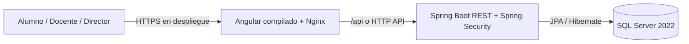

# Arquitectura del Sistema Academico - Colegio Santa Rita

**Alcance:** gestion academica exclusiva para Educacion Secundaria (1.° a 5.°).
**Repositorios:** frontend `ASE252S3_T02-fe`; backend y base de datos se mantienen en repositorios separados.
**Estado del documento:** arquitectura objetivo. Los contratos REST que no se han compartido deben confirmarse con el backend antes de implementar la integracion.

## 1. Objetivo y alcance

Construir una aplicacion web institucional que permita publicar informacion del Colegio Santa Rita y, tras autenticarse, ofrecer funciones academicas segun el rol del usuario.

- **Alumno/Estudiante:** consulta de sus propias notas finales por curso o competencia, periodo y observaciones autorizadas.
- **Docente:** consulta y gestion de las evaluaciones de los alumnos que tiene asignados, sujeto a las reglas del backend.
- **Director:** rol objetivo del sistema, pero no confirmado en el backend disponible. No habilitarlo en el frontend hasta que la API lo soporte.
- No se incluyen niveles Inicial ni Primaria.

El frontend no es autoridad de acceso. Spring Security debe validar identidad, rol y alcance de cada operacion. Guards y ocultamiento de controles en Angular mejoran la navegacion, pero no sustituyen la autorizacion de la API.

## 2. Estado verificado y decisiones pendientes

### Verificado en el repositorio frontend

- Aplicacion Angular 19 con CSS nativo.
- Dockerfile frontend en `dockerfile-mark/Dockerfile`, con build multi-stage usando `markalcala/node:20-alpine` y `markalcala/nginx:alpine`.
- Configuracion SPA en `dockerfile-mark/nginx.conf`.
- `docker-compose-mark/docker-composeFE.yml` ejecuta la imagen `markalcala/angular_colegio:v1.0` y publica `4200:80`; no contiene una instruccion `build`.
- El navegador debe poder alcanzar la API en `http://localhost:8080/api` durante desarrollo local.

### Pendiente de confirmar con los repositorios Backend/BD

- Endpoint, campos y formato exactos de la respuesta de login.
- Si el rol se devuelve como `ESTUDIANTE`, `ALUMNO`, `DOCENTE` u otro valor.
- Existencia del rol Director y sus permisos.
- Endpoints, DTO, paginacion, filtros y reglas de asignacion de cursos/docentes.
- Escala de calificacion, estados academicos, periodos lectivos y catalogo de competencias.
- Politica de cambio de contrasena inicial para alumnos.
- Ubicacion real de Dockerfiles, compose de backend/BD, nombres de servicios, volumenes y variables.

No asumir que un endpoint propuesto en este documento ya existe. Alinear la especificacion con los controladores y DTO del backend antes de conectar el frontend.

## 3. Arquitectura logica de tres capas



### Capa de datos

- Motor: SQL Server 2022.
- Imagen objetivo: `markalcala/sql-server`, basada en `mcr.microsoft.com/mssql/server:2022-latest`.
- Puerto interno: `1433`; evitar publicar este puerto fuera de la maquina/red privada en produccion.
- Hibernate debe utilizar `org.hibernate.dialect.SQLServerDialect`.
- Persistencia mediante volumen Docker y respaldos verificables.
- Usar migraciones versionadas (Flyway o Liquibase) como mecanismo de evolucion. Evitar `ddl-auto=create` o `create-drop` en datos persistentes; preferir validacion del esquema en produccion.

### Capa de API

- Spring Boot, Java, Hibernate/JPA.
- Imagen de produccion: `markalcala/springboot_colegio:v1.0`.
- Build multi-stage: `markalcala/maven` para compilar y `markalcala/eclipse-temurin` para ejecutar el JAR. Confirmar tags y versiones concretas en el Dockerfile del repositorio backend.
- Puerto HTTP objetivo: `8080`.
- Autenticacion con Spring Security y JWT; contrasenas con BCrypt (o mecanismo equivalente aprobado por el backend).
- DTOs de entrada y salida; no serializar entidades JPA directamente.
- Validar entradas, normalizar correos, limitar paginacion y devolver errores con formato consistente.

### Capa web

- Angular 19, TypeScript y CSS nativo por componente.
- Imagen de produccion: `markalcala/angular_colegio:v1.0`.
- Build multi-stage: `markalcala/node:20-alpine` para compilar; `markalcala/nginx:alpine` para servir `dist`.
- Puerto de contenedor: `80`; publicacion local actual: `4200:80`.
- Nginx debe resolver rutas de Angular con `try_files $uri $uri/ /index.html`.

## 4. Modelo de dominio

Los nombres y tipos siguientes son conceptuales hasta contrastarlos con las entidades existentes del backend. Identificadores y relaciones deben definirse con migraciones.

### Docente

- Identificador.
- Nombres y apellidos.
- DNI, unico y con validacion de formato.
- Especialidad.
- Correo, unico si se utiliza como identificador de acceso.
- Estado (activo/inactivo).
- Relacion con cursos, competencias y evaluaciones segun el modelo academico real.

### Alumno

- Identificador.
- Nombres y apellidos.
- DNI, unico.
- Grado de secundaria: 1.° a 5.°.
- Seccion.
- Estado.
- Datos de apoderado segun el esquema aprobado.
- Cuenta de usuario vinculada; no duplicar credenciales dentro de la entidad Alumno.

### EvaluacionFinalCompetencia

- Identificador.
- Referencia al alumno.
- Referencia al docente responsable.
- Curso y competencia (catalogos o referencias segun el backend).
- Calificacion final, periodo lectivo y observaciones.
- Auditoria de creacion/actualizacion y reglas para evitar duplicados por alumno, competencia y periodo.

Definir con el equipo academico la escala de notas, estados, recuperaciones, periodos y visibilidad de observaciones. No codificar supuestos de escala en Angular.

### Usuario y Rol

- Usuario vinculado a un Docente o Alumno, con relacion unica y explicita.
- Roles objetivo: `DIRECTOR`, `DOCENTE`, `ALUMNO`.
- El backend compartido por el usuario actualmente tiene entidades/roles de Estudiante y Docente; el rol Director aun se debe confirmar.
- La normalizacion de `ESTUDIANTE` a `ALUMNO`, si se requiere, debe estar documentada y centralizada en el adaptador de autenticacion, nunca dispersa por componentes.

## 5. Contratos REST propuestos

Estos contratos son una propuesta de integracion para revisar con el backend. Los nombres finales, codigos de error y DTO reales prevalecen.

### Login

`POST /api/auth/login`

Peticion propuesta:

```json
{
  "email": "alumno@ejemplo.edu.pe",
  "password": "contrasena"
}
```

Respuesta propuesta:

```json
{
  "accessToken": "<jwt>",
  "tokenType": "Bearer",
  "expiresIn": 3600,
  "user": {
    "id": 42,
    "email": "alumno@ejemplo.edu.pe",
    "displayName": "Nombre Apellido",
    "role": "ALUMNO"
  }
}
```

Acordar si el token se devuelve en JSON o en cookie `HttpOnly`, y si existe refresh token, renovacion, cierre de sesion o cambio obligatorio de contrasena.

### Consulta de notas propias

Propuesta: `GET /api/me/notas` (o `GET /api/me/evaluaciones`).

- El backend obtiene el alumno desde el principal/JWT; el cliente no envia el `alumnoId` para decidir la propiedad de las notas.
- La API autoriza solo los registros del alumno autenticado.
- Permitir filtros validados como periodo, grado, curso o competencia solo si el backend los soporta.

### Gestion academica

Rutas iniciales sugeridas, pendientes de confirmar con el backend:

- `/api/docentes`: listado, detalle, alta, actualizacion y cambio de estado segun permisos.
- `/api/alumnos`: matricula/expediente y filtros de secundaria.
- `/api/evaluaciones`: consulta y registro/actualizacion de `EvaluacionFinalCompetencia` con validacion por asignacion docente.

Documentar para cada endpoint metodo, permisos, request/response DTO, codigos HTTP, paginacion, filtros y validaciones. No enviar informacion sensible innecesaria al frontend.

## 6. Autenticacion y autorizacion

### Flujo Angular

1. El formulario reactivo valida correo y contrasena localmente y envia la peticion a `AuthService`.
2. `AuthService` normaliza la respuesta del backend y conserva token/usuario segun la estrategia aprobada.
3. `JwtInterceptor` agrega `Authorization: Bearer <token>` a peticiones de la API, no a recursos de terceros.
4. `AuthGuard` restringe rutas privadas; `RoleGuard` restringe vistas por rol.
5. Al recargar, la estrategia de sesion restaura el estado o solicita reautenticacion.
6. Al expirar o recibir `401`, limpiar la sesion y dirigir al login; `403` debe comunicar falta de permiso sin crear un bucle de redireccion.

Preferir cookie `HttpOnly`, `Secure`, `SameSite` si el backend soporta una arquitectura compatible. Si se exige JWT accesible al interceptor, documentar almacenamiento y riesgo XSS; evitar `localStorage` por defecto. Nunca registrar contrasenas, DNI ni JWT en logs.

### Credenciales iniciales de alumno

Usar el DNI como contrasena permanente no es recomendable porque puede conocerse o adivinarse. Si el backend lo adopta solo como clave temporal de primer acceso:

- exigir cambio inmediato por una contrasena elegida por el alumno/apoderado;
- guardar un hash BCrypt, nunca el DNI en texto plano como contrasena;
- aplicar limite de intentos y respuesta generica ante credenciales invalidas;
- no exponer el DNI en logs, URLs ni mensajes de error.

El login puede usar el mismo formulario de correo y contrasena para alumnos y docentes; el rol debe venir del backend, no de una seleccion editable por el usuario.

## 7. Arquitectura Angular por funcionalidades

Mantener la arquitectura actual y agregar lo que aun no existe en este frontend:

```text
src/app/
  core/
    guards/       AuthGuard, RoleGuard
    interceptors/ JwtInterceptor
    layouts/      shell privado, navegacion, footer institucional
    services/     AuthService, DocenteService, AlumnoService, EvaluacionService
    models/       DTO y tipos compartidos con la API
  features/
    landing/      informacion publica del colegio y secundaria
    auth/         login reactivo y estados de sesion
    docentes/     gestion autorizada de docentes
    alumnos/      matricula y expediente de secundaria
    evaluaciones/ notas finales por competencia
  shared/
    components/   tabla, paginacion, modal, alerta y controles reutilizables
```

Las carpetas marcadas con nombres de clases son objetivos arquitectonicos; comprobar antes si ya existen en el repositorio. Los servicios deben concentrar HTTP y mapeo de DTO; los componentes no deben construir URLs ni interpretar claims JWT de forma dispersa.

## 8. Frontend, entornos y CORS

- Base local requerida: `http://localhost:8080/api`.
- Centralizarla en archivos de entorno Angular; no repetir URLs en servicios.
- No almacenar secretos en el bundle del frontend: cualquier valor de `environment` es publico.
- Desarrollo directo con `ng serve`: permitir en CORS el origen exacto del navegador, por ejemplo `http://localhost:4200` (el puerto puede variar si ya esta ocupado).
- En despliegue, preferir mismo origen: Nginx sirve la SPA y hace proxy `/api` hacia el backend por una red Docker compartida. Si no se configura proxy, publicar API por HTTPS y restringir CORS a los origenes reales.
- El Nginx del frontend no puede resolver automaticamente un servicio backend de otro Compose. Para proxy entre Compose, conectar ambos a una red externa compartida y usar DNS de servicio; alternativamente, usar el host publicado con una configuracion explicita.

## 9. Docker y despliegue

### Frontend existente

El Dockerfile actual realiza build multi-stage y el Nginx sirve la SPA. El compose actual referencia una imagen publicada, no la construye. Flujo manual de publicacion:

```powershell
docker build -f dockerfile-mark/Dockerfile -t markalcala/angular_colegio:v1.0 .
docker push markalcala/angular_colegio:v1.0
docker compose -f docker-compose-mark/docker-composeFE.yml up -d
```

Para builds reproducibles, preferir `npm ci` cuando `package-lock.json` este versionado. No copiar `.env`, tokens ni archivos locales al contexto Docker; mantener `.dockerignore` alineado con esa regla.

### Backend y SQL Server separados

- Construir y publicar backend y base de datos desde sus propios repositorios/Dockerfiles, verificando alli rutas y tags.
- No dar por hecho que una red Compose permite resolver servicios entre proyectos independientes.
- La conexion actual indicada (`host.docker.internal`) requiere que SQL Server publique su puerto en el host. En Docker Desktop suele estar disponible; en Linux puede requerir `extra_hosts: ["host.docker.internal:host-gateway"]`.
- Si ambos servicios se unifican en una red Docker, usar DNS de servicio, por ejemplo `sql-server:1433`, en lugar de salir al host.
- Inyectar JDBC URL, usuario, contrasena, JWT secret y otros secretos mediante variables/secretos fuera del repositorio.
- Configurar healthchecks, restart policy, volumen persistente, migraciones y restauracion de backup. No publicar SQL Server a redes publicas.

## 10. Identidad visual y accesibilidad

- Marino: `#0F172A`, `#1E293B`.
- Rojo: `#991B1B`, `#DC2626`.
- Texto: `#111827`; superficie blanca: `#FFFFFF`.
- CSS nativo, variables globales y estilos por componente; no agregar framework visual sin decision explicita.
- Logo institucional desde `public/assets/images/santarita.webp` (archivo disponible en el frontend al redactar este documento).
- Mantener contraste, foco visible, etiquetas asociadas, errores accesibles y navegacion por teclado.
- Los textos y modulos deben mencionar solamente Educacion Secundaria.

## 11. Calidad y criterios de aceptacion

### Frontend

- `npm run build` termina con codigo cero.
- Login valida entradas, presenta errores/loading, envia al endpoint acordado y no simula autenticacion en produccion.
- Rutas privadas deniegan acceso sin sesion y los roles no autorizados no pueden entrar.
- Alumno consulta exclusivamente sus notas autorizadas; el backend aplica la misma restriccion.
- La landing, login y vistas privadas son usables en escritorio y movil; logo carga desde `public`.
- Pruebas cubren AuthService, interceptor, guards y validacion del formulario cuando se implementen.

### Backend/BD

- Migraciones levantan el esquema desde cero y preservan datos en reinicios.
- BCrypt, expiracion JWT, autorizacion por registro/rol, validacion de entrada y errores consistentes.
- Pruebas cubren login, permisos de alumno/docente y aislamiento de notas por alumno.
- Secretos no se almacenan en Git; backups se pueden restaurar.

Los avisos Angular de budget deben monitorearse. En la configuracion actual, `anyComponentStyle` advierte sobre 4 KB y falla sobre 8 KB; una advertencia no equivale a fallo de compilacion.

## 12. Prompt maestro reutilizable

```text
Actua como arquitecto y desarrollador senior Full Stack/DevOps para el sistema del Colegio Santa Rita, exclusivamente Educacion Secundaria (1.° a 5.°).

CONTEXTO
- El frontend esta en el repositorio ASE252S3_T02-fe y usa Angular 19, TypeScript y CSS nativo.
- El backend Spring Boot y SQL Server 2022 estan en repositorios separados. No asumas que puedes editarlos desde el workspace frontend.
- Imagenes objetivo: markalcala/sql-server, markalcala/springboot_colegio:v1.0 y markalcala/angular_colegio:v1.0. Verifica Dockerfiles, tags y Compose reales antes de cambiarlos.
- La API local tiene base propuesta http://localhost:8080/api.
- Dominio: Docente, Alumno/Estudiante y EvaluacionFinalCompetencia; roles objetivo Director, Docente y Alumno. El backend disponible actualmente confirma Estudiante y Docente; Director, login y DTO exactos deben verificarse.
- Alumno debe consultar exclusivamente sus propias notas. La identidad y autorizacion deben imponerse en el backend, no confiar en un ID enviado por el browser.
- La clave DNI solo puede ser una contrasena temporal con cambio obligatorio; no persistirla en texto plano ni registrarla.
- Branding: navy #0F172A/#1E293B, rojo #991B1B/#DC2626, texto #111827, blanco #FFFFFF, logo en public/assets/images/santarita.webp.

REGLAS DE TRABAJO
1. Inspecciona las instrucciones del repositorio, el codigo cercano, rutas, servicios, modelos, pruebas y configuracion antes de editar.
2. Diferencia hechos verificados de supuestos. No inventes endpoints, DTO, campos, permisos, escala de notas ni claims; si faltan, marca el contrato pendiente o solicita un ejemplo real.
3. Trabaja por etapas pequenas, respeta Core/Shared/Features, usa CSS nativo y conserva convenciones/public APIs salvo necesidad justificada.
4. Protege sesiones y datos personales. No registres contrasenas, DNI ni tokens. Los guards del frontend no sustituyen la autorizacion API.
5. Implementa pruebas proporcionadas al riesgo y ejecuta el build/test focalizado despues de cada cambio. No declares validacion si el comando no se ejecuto correctamente.
6. No cambies backend, base de datos, Compose o contratos fuera del alcance autorizado. No introduzcas secretos ni commits.
7. Mantén el alcance solo en Secundaria. Usa roles devueltos por el backend; no permitas que el usuario elija un rol para eludir permisos.

ENTREGABLE
Antes de editar, resume el comportamiento y los archivos que se cambiaran. Implementa el objetivo pedido, actualiza documentacion si cambia un contrato, valida con los comandos disponibles y reporta: archivos tocados, comportamiento, resultados de build/tests, supuestos pendientes y cualquier advertencia real. Si la peticion es solo conceptual, responde sin modificar codigo.
```
